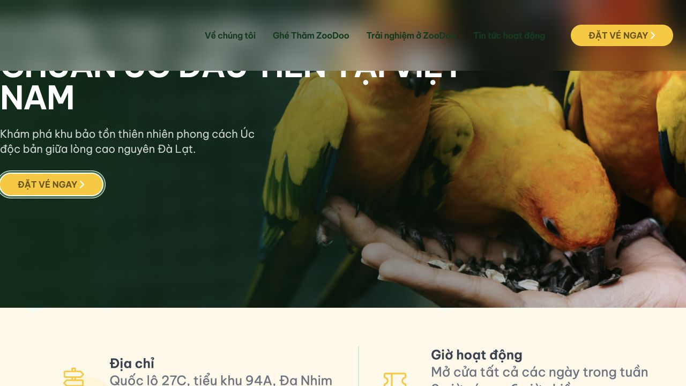
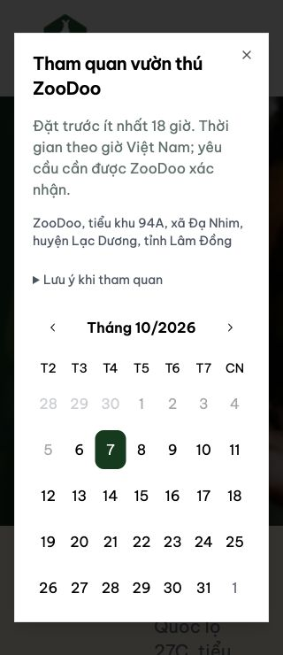

# Kết quả sửa audit ZooDoo — 06/10/2026

Bản tích hợp trên `codex/audit-remediation`, xuất phát từ staging commit `620831a62f65e42f3ede8dde2aeb5273dfd90df5`. Domain `zoodoo.vn`, frontend Vercel, không giới hạn sức chứa suất, giữ quy định đặt trước 18 giờ và xác nhận thủ công.

**Mã nguồn đã có bản sửa cho các phát hiện F01–F28. Chưa coi đây là release production hoặc đóng toàn bộ audit:** F02 còn một advisory trong công cụ build/lint; các kiểm chứng hạ tầng private/volume/backup, dữ liệu CMS thật, SMTP thật và vận hành trên staging chưa thực hiện vì chưa có môi trường/quyền tương ứng. Main và staging chưa nhận commit ứng dụng mới.

## Kết quả đã kiểm chứng

- Production build Next 16.3.8 hoàn tất; typecheck frontend/API và lint đạt. Gói API production được đóng riêng, generate Prisma client lại tại nơi đóng gói và khởi tạo runtime thành công.
- **15/15 test đạt**, dùng MongoDB replica set thật với dữ liệu giả: auth service/guest/staff, quyền đọc/sửa/xác nhận, user bị xóa, phiên hỏng/thu hồi, validation, concurrency/idempotency, CV byte đúng/quyền tải/lưu qua API restart, SMTP lỗi/timeout/stale worker và đối soát.
- Qua frontend production cục bộ: booking tiếp nhận đúng trạng thái, form contact gửi thành công; CV **5 MiB** tải 3 phần và lưu thành công; request khác origin bị **403**; admin thiếu phiên/phiên hỏng chuyển về đăng nhập (**307**).
- UI desktop, mobile 320/390/430 px; ở 320 px modal có width/scrollWidth **286/286**, trang **320/320**, không tràn ngang. Menu đóng bằng Escape, focus trở lại nút mở. Label liên kết đúng các input quan sát được. Một H1 và H2/H3 đúng trong nội dung trang chủ.
- Dependency runtime của cả workspace: **0 advisory**. Full audit còn **1 high ở braces**, chỉ trong chuỗi công cụ lint/Tailwind; advisory chưa có patched version. Đây là phần tồn riêng, không tính thành nhiều lỗi website.
- Các cặp màu chính được tính theo luminance sRGB: xanh/mint **12,22:1**, chữ CTA/amber **6,0:1** (hover **5,51:1**), gold/footer **4,98:1**, cream/footer **8,81:1**, chữ phụ/mint **8,93:1**. Chưa tuyên bố website đạt chứng nhận WCAG toàn diện.
- Hero gốc **1.291.037 byte**; endpoint tối ưu AVIF trả **9.667 byte tại 750 px**, **32.200 byte tại 1920 px**, status 200. Đây là đo payload cùng ảnh trên server cục bộ, **không phải điểm Lighthouse/LCP/CLS production**.

Bằng chứng nhỏ được lưu trong [verification](verification/): [test](verification/tests-final.txt), [build](verification/build-final.txt), [HTTP](verification/http-verification.json), [runtime audit](verification/audit-runtime.json), [màu](verification/contrast.json). Không chứa credentials hoặc dữ liệu khách thật. SMTP worker của bản thử giao diện bị tắt để không gửi thư.

## Đối chiếu 28 phát hiện

| Mã       | Lỗi gốc                                                        | Cách xử lý và giới hạn kiểm chứng                                                                                                                                                                                                                 |
| -------- | -------------------------------------------------------------- | ------------------------------------------------------------------------------------------------------------------------------------------------------------------------------------------------------------------------------------------------- |
| F01 · P0 | Booking/action quản trị thiếu auth/authz; guard bỏ sót URL con | API kiểm tra service identity + phiên + quyền cho từng đọc/sửa/xác nhận. Layout/route/action kiểm tra lại phiên; test guest/read-only không đọc/ghi trái quyền.                                                                                   |
| F02 · P1 | Next/dependency cũ có lỗ hổng                                  | Nâng Next 16.3.8, React 19, SDK và công cụ tương thích; bỏ dependency email/share cũ, vá Swiper và override deepmerge-ts. Build/test/runtime audit đạt; **braces ở dev tooling còn tồn**.                                                         |
| F03 · P1 | Form submit sai, GET external service, CV không gửi đúng       | Form POST có trạng thái, giữ nội dung khi lỗi; CV qua upload phần → frontend → API. Contact và CV 5 MiB qua frontend đã kiểm chứng.                                                                                                               |
| F04 · P1 | Booking thiếu validation; suất hardcode 2024                   | Zod strict server, kiểm tra số người/email/giờ/duration/18 giờ; policy và closure từ DB. Không tự đặt capacity. Test dữ liệu giả và ngày đóng suất đạt.                                                                                           |
| F05 · P1 | Contact/CV không có quyền/rate-limit/validation, HTML unsafe   | Phiên khách giới hạn quyền, rate limit DB, giới hạn byte trước parse, kiểm tra MIME từ nội dung, file private, HTML email escape. Tải CV yêu cầu file:read.                                                                                       |
| F06 · P1 | User đã xóa vẫn login/session hoạt động                        | Login và từng request kiểm tra deletedAt/session revoked/expiry và quyền; test từ chối đạt.                                                                                                                                                       |
| F07 · P1 | SMTP thất bại vẫn báo ok                                       | Record + outbox cùng transaction; thông báo UI chỉ nói đã tiếp nhận. Retry có trạng thái, timeout/stale thành UNKNOWN và đối soát trước gửi lại; test đạt. Chưa gửi SMTP staging thật.                                                            |
| F08 · P1 | Lịch mất ngày đầu/cuối tháng                                   | Tạo grid từ thứ Hai, đủ toàn bộ ngày tháng và ô kề; test Nov/Aug, nhuận/giao năm đạt.                                                                                                                                                             |
| F09 · P1 | Giờ phụ thuộc múi giờ thiết bị                                 | Instant UTC, hiển thị/tính suất bằng Asia/Ho_Chi_Minh; test VN/New York/London cùng 09:00 → 02:00Z đạt.                                                                                                                                           |
| F10 · P1 | Pagination nhận tổng trang thay tổng bài                       | Truyền totalPosts đúng, validate page, redirect vượt khoảng. Cần xác minh danh sách nhiều trang với CMS staging thật.                                                                                                                             |
| F11 · P1 | Contact/CV không lưu bền vững                                  | Contact/FileAsset/UploadPart/outbox trong DB, byte CV trên volume private. Test API close/recreate giữ file đạt; **Docker restart/recreate + restore trên volume thật còn phải kiểm**.                                                            |
| F12 · P1 | Frontend truy cập DB trực tiếp                                 | Prisma/DB/SMTP chuyển vào API; frontend chỉ chuyển tiếp có service auth. Build từ chối DB/SMTP credentials ở frontend. Template mạng/volumes/secrets đã có; **chưa dựng private connectivity từ Vercel**.                                         |
| F13 · P1 | Không có luồng staging                                         | Staging đã tạo; main/staging có required checks Verify + Merge policy, yêu cầu PR, enforce admins, chặn force-push/xóa. CI main chỉ nhận nguồn staging của cùng repo. Bản sửa mở PR vào staging; chưa merge main.                                 |
| F14 · P1 | Label thiếu/sai trường                                         | ID duy nhất, htmlFor/autocomplete/type đúng cho các form; booking có aria-invalid/describedby; kiểm tra AX form khách đạt, admin đã typecheck/review.                                                                                             |
| F15 · P1 | Nút không tên, focus/Escape kém                                | Nút menu/carousel/pagination/dialog/toast có tên; Radix quản lý overlay/focus; focus visible. Escape/return focus menu đã kiểm chứng.                                                                                                             |
| F16 · P2 | Modal mobile nhiều vùng cuộn/tràn cột                          | Một vùng cuộn, mô tả trong details, ngày → giờ → thông tin, span theo breakpoint. Sửa thêm footer tràn 320 px; kiểm tra kích thước trang/modal đạt. Chưa mô phỏng bàn phím ảo iOS thật.                                                           |
| F17 · P2 | Drag chỉ đổi start, không await/rollback                       | Calendar giờ VN, chuyển cả start/end, await server, revert khi lỗi, không resize duration; API validate và update chống ghi đè. Cần kéo/thả bằng tài khoản staging thật để đóng kiểm chứng UI vận hành.                                           |
| F18 · P2 | Lỗi im lặng, Undo không làm gì                                 | Loại Undo giả; hiển thị lỗi kỳ vọng qua kết quả action/form, nút thử lại và trạng thái mail. Nhân viên xem hồ sơ/email và retry theo quyền.                                                                                                       |
| F19 · P2 | Cookie hỏng gây 500, Secure mặc định tắt                       | Token opaque hash ở DB, HttpOnly/SameSite Strict/Secure production; phiên hỏng/thu hồi từ chối. Test API và HTTP admin cookie hỏng không 500.                                                                                                     |
| F20 · P2 | Sitemap sai biến/path                                          | SITE_URL=zoodoo.vn, route /ve-zoodoo, job/news slug hợp lệ, lấy đủ slug bằng pagination CMS. Cần kiểm tra XML và 200 từng URL với CMS staging.                                                                                                    |
| F21 · P2 | Asset/domain/locale OG sai, thiếu metadata bài                 | Asset /logos đúng, metadataBase/OG zoodoo.vn, vi_VN, metadata article/job và canonical. CMS/social crawler thật chưa có credentials để xác minh. Email liên hệ hello@zoodoodalat.com được giữ theo thông tin hiện có, không tự đổi địa chỉ email. |
| F22 · P2 | Heading/main chưa đúng                                         | Main landmark/skip link; H1 hero và đầu trang; H2 section/H3 card. Cấu trúc main trang chủ được kiểm tra DOM, bài/job đã review/typecheck.                                                                                                        |
| F23 · P2 | Footer sai route, CTA thiếu rõ ràng, nested button/link        | Footer Trải nghiệm đúng route; CTA giá vé mở booking, CTA điện thoại ghi Gọi đặt vé; bỏ anchor lồng button.                                                                                                                                       |
| F24 · P2 | Hero background lớn, fill thiếu sizes                          | Hero Next Image + sizes/priority, AVIF/WebP; bổ sung sizes cho grid. Đã đo payload ảnh; chưa đo Web Vitals production.                                                                                                                            |
| F25 · P1 | CTA xanh contrast 2,61 và màu literal lệch token               | Màu semantic xanh/amber/text/surface/footer, sửa link phụ và focus. Tính các cặp màu chính đạt AA; còn cần kiểm tra toàn bộ trạng thái/nội dung ảnh trên staging.                                                                                 |
| F26 · P2 | Media query only ≈screen không áp dụng                         | Sửa media query; carousel/nút dùng kích thước mobile. Desktop/mobile đã quan sát trong lượt UI giới hạn.                                                                                                                                          |
| F27 · P2 | Hero ẩn chờ hydration, không reduced motion                    | initial=false cho hero/reveal; xử lý useReducedMotion/CSS giảm transition/animation/hover scale. Chưa kiểm tra OS/device accessibility đầy đủ.                                                                                                    |
| F28 · P2 | Slug substring, CMS rỗng lỗi, thiếu hướng dẫn                  | Equality slug, guard document/ảnh/date, not-found/empty/error rõ; CMS server-only timeout; .env.example, README, hướng dẫn schema/backup/rollback. Cần CMS staging thật cho toàn luồng nội dung.                                                  |

## Cần trước release

1. Chỉ định host API/MongoDB, volume staging và kết nối private từ Vercel (không expose API public). Review/diễn tập Docker template; máy làm việc hiện không có Docker.
2. Cấu hình encrypted secrets riêng cho frontend/API, CMS và SMTP sandbox; bỏ DB/SMTP credentials khỏi frontend. Chỉ API nhận URI DB/account tối thiểu.
3. Snapshot dữ liệu trước thay schema; apply bổ sung schema/index trên staging, giữ User/Booking cũ. Cấp quyền cho tài khoản được chỉ định; phiên cũ đăng nhập lại.
4. Chạy kiểm chứng mạng, restart/recreate/restore, CMS/sitemap và vận hành booking → admin → SMTP trên staging; xác nhận thời hạn lưu CV/hồ sơ.
5. Sau khi đạt các kiểm tra và xử lý phần tồn mới merge staging → main. Không có thay đổi schema/deploy production trong phiên sửa này.

